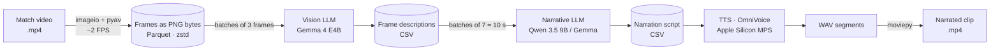

# Local AI Video Analysis Pipeline

End-to-end pipeline that turns football match footage into a narrated video report using **only locally hosted AI models**: frames → visual captions → narrative script → synthetic voice → final video.


[](LICENSE)

## Context

Final project for the *Advanced Data Processing and Analysis* course (2nd year, BI & Data Analytics, La Salle – Universitat Ramon Llull).

The question: **can a multimodal pipeline (vision → language → speech) run entirely offline on a laptop?** Running locally means no cloud costs per call and no need to upload copyright-sensitive footage to third-party APIs. The focus is on connecting local models and handling the data efficiently, not on video editing.

## Architecture



| Stage | Notebook | What it does |
|---|---|---|
| 1. Framing | [`01_framing.ipynb`](01_framing.ipynb) | Reads every 12th frame of a 25 FPS video (~2 FPS) and stores the PNG bytes in a Parquet file with `zstd` level 22. Parquet replaced CSV and NumPy arrays, which were too large on disk. |
| 2. Captioning | [`02_captioning.ipynb`](02_captioning.ipynb) | Sends batches of 3 frames as base64 images to a vision model served by LM Studio's OpenAI-compatible API. The prompt includes both line-ups so the model can name players. |
| 3. Narration | [`03_narration.ipynb`](03_narration.ipynb) | Groups 7 descriptions (≈10 s of play) into one broadcast-style sentence of at most 22 words, passing the previous sentence along to keep continuity. |
| 4. Text-to-speech | [`04_tts.ipynb`](04_tts.ipynb) | Synthesises each sentence with OmniVoice, cloned from a reference voice sample, on Apple Silicon (`mps`, float16). |
| 5. Assembly | [`05_video_assembly.ipynb`](05_video_assembly.ipynb) | Concatenates the audio segments with `moviepy` and lays them over a muted 60-second clip of the match. |

## Results

- A **60-second clip narrated end to end** with 6 generated voice segments. Every model ran locally through LM Studio and PyTorch.
- Real intermediate outputs are in [`samples/`](samples). Here are two generated narration lines (Spanish):

> *"Mientras Xavi mantiene la posesión en el mediocampo central, Real Madrid busca desesperadamente explotar con Cristiano y Di María por el flanco derecho."*
>
> *"Aunque Di María busca por la banda derecha, Barcelona cambia el juego hacia el centro con Xavi e Iniesta, forzando al Real Madrid a reorganizar su estructura defensiva."*

## Limitations

- **Player names come from the line-up in the prompt.** The vision model does not truly identify players, so names in captions can be wrong.
- The narration was checked by eye only. There is no quantitative evaluation of caption or narration accuracy.
- The pipeline was tested on short segments (about one minute of play), not a full match.
- The TTS notebook targets Apple Silicon (`device_map="mps"`). Use `"cuda"` or `"cpu"` on other hardware.

## How to run

**Requirements:** Python 3.12+, [LM Studio](https://lmstudio.ai) with its local server enabled (default `http://localhost:1234/v1`) and the models `google/gemma-4-e4b` and `qwen/qwen3.5-9b` downloaded, plus `ffmpeg` for `moviepy`.

```bash
git clone https://github.com/datamauriciovaldez/local-ai-video-analysis-pipeline.git
cd local-ai-video-analysis-pipeline
python -m venv .venv && source .venv/bin/activate
pip install -r requirements.txt
cp .env.example .env            # then fill in the values
set -a && source .env && set +a # export the variables for Jupyter
jupyter lab
```

Run the notebooks in order (`01` → `05`). All intermediate files are written to `data/`, which is git-ignored.

> `01_framing` writes `data/second_half.parquet`, while `02_captioning` reads `data/first_time.parquet` because the frames were extracted once per half. Adjust the frame range and file name to the part of the match you want to process.

### Environment variables

| Variable | Purpose |
|---|---|
| `VIDEO_PATH` | Path to the source video (default `data/match.mp4`) |
| `LMSTUDIO_BASE_URL` | LM Studio server URL (default `http://localhost:1234/v1`) |
| `LMSTUDIO_API_KEY` | Any string; LM Studio does not check it (default `lm-studio`) |
| `REF_AUDIO` | Short voice sample used as the TTS reference voice |
| `REF_TEXT` | Exact transcript of `REF_AUDIO` |

## Data & rights

**No video or audio is included.** Match footage is copyrighted, so use footage you have the rights to. For the TTS reference voice, use your own voice or one you have permission to clone.

## Project structure

```
local-ai-video-analysis-pipeline/
├── 01_framing.ipynb
├── 02_captioning.ipynb
├── 03_narration.ipynb
├── 04_tts.ipynb
├── 05_video_assembly.ipynb
├── samples/
│   ├── frame_descriptions.csv   # real output of stage 2
│   └── narration.csv            # real output of stage 3
├── data/                        # video, Parquet, WAV, MP4 (git-ignored)
├── .env.example
├── requirements.txt
└── LICENSE
```

## License

Code under the [MIT License](LICENSE).
