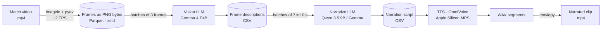
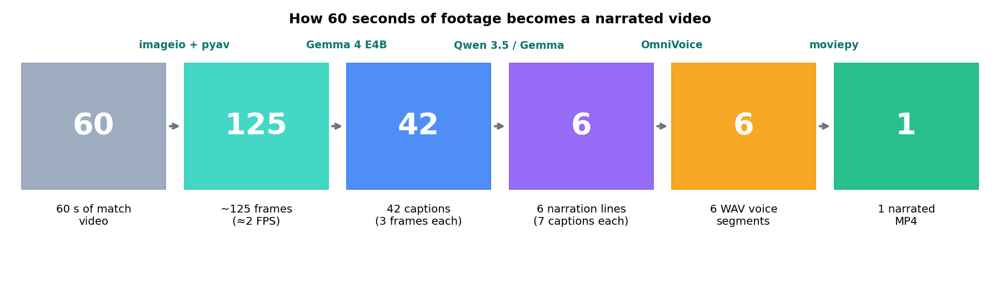
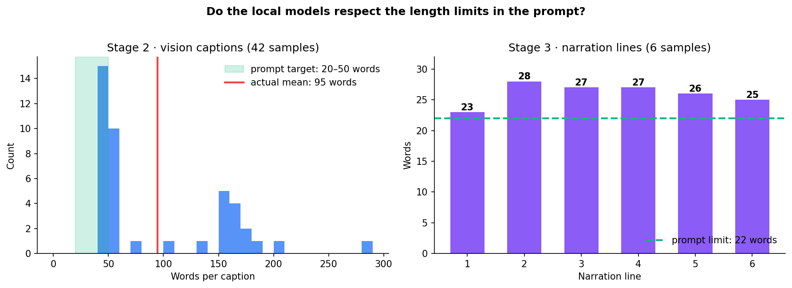

<div align="center">

<picture>
  <source media="(prefers-color-scheme: dark)"  srcset="docs/banner-dark.svg">
  <source media="(prefers-color-scheme: light)" srcset="docs/banner-light.svg">
  
</picture>

# 🎙️ From Match Video to Live Commentary with Local AI

**Turns football match footage into a narrated video using only locally hosted AI models.**<br>
frames → vision captions → commentary script → synthetic voice → final video


[](LICENSE)

*Final project · Advanced Data Processing and Analysis · BI & Data Analytics, La Salle – Universitat Ramon Llull*
*Authors: Mauricio Valdez Fusté, Mael Baudran & Javier Gonzalo*

</div>

---

## 📑 Contents

1. [The project in one minute](#-the-project-in-one-minute)
2. [Architecture](#-architecture)
3. [The five stages in detail](#-the-five-stages-in-detail)
4. [Results and demonstration](#-results-and-demonstration)
5. [Design decisions](#-design-decisions)
6. [Limitations and honest caveats](#-limitations-and-honest-caveats)
7. [Key takeaways](#-key-takeaways)
8. [Glossary](#-glossary-for-non-specialists)
9. [Run it yourself](#%EF%B8%8F-run-it-yourself)
10. [Project structure](#-project-structure)

---

## 📌 The project in one minute

Imagine a radio commentator who watches a match and describes it live. This project builds an **automatic one, that runs entirely on a laptop**: it watches the video, writes what it sees, turns those notes into a broadcast-style sentence, and reads it aloud in a synthetic voice, with no internet and no paid API.

| | |
|---|---|
| **Question** | Can a multimodal pipeline (vision → language → speech) run **entirely offline** on a laptop? |
| **Why local?** | No cost per call, and no need to upload copyright-sensitive footage to third-party servers. |
| **Input** | A match video (`.mp4`) and a short reference voice sample. |
| **Output** | The same clip with a Spanish football commentary laid over it. |
| **Models** | 3 local models: **Gemma 4 E4B** (vision), **Qwen 3.5 9B / Gemma** (narration), **OmniVoice** (speech). |
| **Focus** | Connecting local models and handling the data efficiently. Not video editing. |

| ⏱️ 60-second clip narrated end to end | 🧠 3 local models | ☁️ 0 cloud calls | 🗜️ frames stored as Parquet (zstd level 22) |
|:--:|:--:|:--:|:--:|

---

## 🏛 Architecture



Every arrow is a notebook boundary: each stage reads the previous stage's file and writes its own, so any stage can be re-run, inspected or swapped on its own.



The data shrinks at every step. 60 seconds of video become ~125 images, then 42 short texts, then just 6 sentences, which become 6 audio files and finally one video.

---

## 🔧 The five stages in detail

### 1 · Framing: video → frames
[`01_framing.ipynb`](01_framing.ipynb)

Reads every 12th frame of a 25 FPS video (≈ 2 frames per second) with `imageio` + `pyav` and stores the raw **PNG bytes** in a Parquet file with `zstd` level 22.

```python
for i in range(N1, N2, 12):                                    # every 12th frame ≈ 2 FPS
    frame = iio.imread(source, index=i, plugin="pyav")
    rows.append({"frame_col": iio.imwrite("<bytes>", frame, extension=".png")})
pl.DataFrame(rows).write_parquet("data/second_half.parquet", compression="zstd", compression_level=22)
```

> **Why Parquet?** CSV and NumPy arrays were far too large on disk. Storing already-encoded PNG bytes also avoids converting NumPy arrays back to images before sending them to the model.

### 2 · Captioning: frames → text
[`02_captioning.ipynb`](02_captioning.ipynb)

Sends **batches of 3 frames**, base64-encoded, to a vision model served by LM Studio through its OpenAI-compatible API. The prompt gives the model the match context and both **line-ups** (shirt numbers and names), asks for a short description (moment, key action, positions, tactics) and tells it to use names instead of numbers.

### 3 · Narration: captions → commentary
[`03_narration.ipynb`](03_narration.ipynb)

Groups **7 captions (≈ 10 seconds of play)** and asks a second model to turn them into **one broadcast-style sentence**. The previous sentence is passed along so the commentary stays continuous. The prompt enforces:

| Rule in the prompt | Why |
|---|---|
| Spanish (Spain), live-broadcast tone, present tense | Sounds like a real commentator |
| Exactly **one sentence, max 22 words** (≈ 10 s spoken) | Matches the time slice of video it describes |
| At least one concrete fact (player, team, pitch zone, action) | Avoids empty filler |
| Narrate the **evolution** (what happens at the start → what changes at the end) | A clip is a sequence, not a still image |
| Link to the previous sentence without repeating it | Continuity across segments |
| No clichés and no meta-comments ("as we can see…") | Keeps it natural |

### 4 · Text-to-speech: commentary → voice
[`04_tts.ipynb`](04_tts.ipynb)

Synthesises each sentence with **OmniVoice**, **cloning a reference voice** (a short audio sample plus its transcript), running on Apple Silicon (`mps`, `float16`, 32 generation steps) and writing 24 kHz WAV files.

### 5 · Assembly: voice + video → final clip
[`05_video_assembly.ipynb`](05_video_assembly.ipynb)

With `moviepy`, concatenates the audio segments, mutes the original clip (a 60-second subclip, 6:00–7:00) and lays the narration on top, encoding with `libx264` + `aac`.

---

## 🎬 Results and demonstration

A **60-second clip narrated end to end** with 6 generated voice segments. Every model ran locally through LM Studio and PyTorch. The real intermediate outputs are in [`samples/`](samples).

### From pixels to commentary: one real example

| Stage | Real output (Spanish) |
|---|---|
| 🎞️ **Stage 2 · caption** of a few frames | *"Se trata de una fase de mediocampo muy intensa y equilibrada en el partido. Xavi Hernández e Iniesta están controlando la posesión del Barça en el centro, mientras que Real Madrid espera con Cristiano Ronaldo y Gareth Bale listos para aprovechar transiciones rápidas por las bandas."* |
| 🎙️ **Stage 3 · narration** after combining 7 captions | *"Mientras Xavi mantiene la posesión en el mediocampo central, Real Madrid busca desesperadamente explotar con Cristiano y Di María por el flanco derecho."* |

Two more generated narration lines:

> *"Aunque Di María busca por la banda derecha, Barcelona cambia el juego hacia el centro con Xavi e Iniesta, forzando al Real Madrid a reorganizar su estructura defensiva."*
>
> *"El Barça mantiene la presión central gracias a Messi y Fàbregas, forzando al Madrid a replegarse en una estructura defensiva más profunda ante la escasez de tiempo."*

### Do the models follow instructions?

We measured the length of the real outputs against the limits written in the prompts:



- **Stage 3:** every narration line is **over the 22-word limit** (23–28 words, mean 26), so the spoken line would run a little longer than the 10 seconds it covers.
- **Stage 2:** the prompt asks for 20–50 words, but only 17 of 42 captions respect it. The median is 53 words and a few run past 150.

This is a useful, honest finding: **small local models follow style instructions well but length limits loosely**. A cheap fix would be to cap output tokens (`max_output_tokens`, left commented out in the notebook) or to add a validation and retry step.

---

## 🧭 Design decisions

| Decision | Reason |
|---|---|
| **Polars + Parquet instead of pandas + CSV** | Frames are heavy binary data. Parquet with `zstd` is compact and fast; CSV could not hold it. |
| **PNG bytes, not NumPy arrays** | The model API takes images as base64. Bytes can be sent directly. MoviePy's NumPy arrays were awkward to convert. |
| **3 frames per caption request** | Lets the vision model see motion across a short span, not a single frozen instant. |
| **7 captions per narration sentence** | 7 × 3 frames ÷ 2 FPS ≈ 10 s, one comfortable spoken sentence. |
| **Pass the previous sentence forward** | Gives the commentary continuity without needing a very long context window. |
| **Line-ups inside the prompt** | The vision model cannot reliably recognise players by face, so names are supplied as context. |
| **A separate notebook per stage** | Each stage persists its output, so a failure in stage 4 never forces re-running the slow stage 2. |

---

## 🔍 Limitations and honest caveats

1. **Player names come from the line-up in the prompt.** The vision model does not truly identify players, so names in captions can be wrong. For example, the prompt's line-up lists Di María as left interior, yet one narration line places him on the right flank.
2. **No quantitative evaluation.** Captions and narration were checked by eye only; there is no accuracy metric against human annotations.
3. **Length limits are not respected** (see the chart above).
4. **Short clips only.** Tested on about one minute of play, not a full match.
5. **Audio is not explicitly synchronised** with the video: the six WAV files are simply concatenated, so the voice can drift against the action.
6. **Apple Silicon specific.** The TTS notebook uses `device_map="mps"`; change it to `"cuda"` or `"cpu"` elsewhere.
7. **Hard-coded course setup.** Frame ranges, the `first_time.parquet` / `second_half.parquet` file names and the model names reflect how the project was run, and need adjusting for new footage.

**Natural next steps** (from the original report):
- Quantise and merge models (GGUF / MLX) to cut memory and speed up inference.
- Move from batch to a real-time streaming pipeline.
- Fine-tune a model with LoRA (for example with `mlx_tune`) on football commentary data.
- Enforce length limits with output-token caps plus validation and retry, and align audio to video timestamps.

---

## 🔬 Key takeaways

1. **A full vision → language → speech pipeline can run offline on a laptop.** It costs nothing per call and keeps footage private.
2. **Data handling matters as much as the models.** Choosing Parquet over CSV made the whole pipeline practical.
3. **Prompts are the interface between stages.** Context (line-ups, the previous sentence) improves the output more than the model size does.
4. **Small local models are good at tone, weaker at constraints.** Always measure the output against the rules you wrote.
5. **Modular stages make iteration cheap.**

---

## 📖 Glossary for non-specialists

| Term | Plain-English meaning |
|---|---|
| **Local model / local inference** | An AI model that runs on your own computer instead of a company's server. |
| **LLM** | Large Language Model: software that reads and writes text. |
| **Vision LLM (multimodal)** | An LLM that can also look at images. |
| **Prompt** | The written instructions given to a model. |
| **TTS (text-to-speech)** | Turning text into a spoken voice. |
| **Voice cloning** | Making synthetic speech that sounds like a given reference voice. |
| **LM Studio** | An app that downloads models and serves them on your computer behind an API. |
| **Parquet** | A compact column-based file format, much more efficient than CSV for large data. |
| **zstd** | A fast compression algorithm; level 22 is the strongest setting. |
| **FPS** | Frames per second. Here ≈ 2 of the video's 25. |
| **MPS** | Apple's GPU acceleration backend for PyTorch. |
| **Batch** | A group of items processed together (3 frames, or 7 captions). |

---

## ▶️ Run it yourself

**Requirements:** Python 3.12+, [LM Studio](https://lmstudio.ai) with its local server enabled (default `http://localhost:1234/v1`) and the models `google/gemma-4-e4b` and `qwen/qwen3.5-9b` downloaded, plus `ffmpeg` for `moviepy`.

```bash
git clone https://github.com/datamauriciovaldez/from-match-video-to-live-commentary-with-local-ai.git
cd from-match-video-to-live-commentary-with-local-ai
python -m venv .venv && source .venv/bin/activate
pip install -r requirements.txt
cp .env.example .env            # then fill in the values
set -a && source .env && set +a # export the variables for Jupyter
jupyter lab
```

Run the notebooks in order (`01` → `05`). All intermediate files are written to `data/`, which is git-ignored.

> `01_framing` writes `data/second_half.parquet`, while `02_captioning` reads `data/first_time.parquet` because the frames were extracted once per half. Adjust the frame range and file name to the part of the match you want to process.

### Environment variables

| Variable | Purpose |
|---|---|
| `VIDEO_PATH` | Path to the source video (default `data/match.mp4`) |
| `LMSTUDIO_BASE_URL` | LM Studio server URL (default `http://localhost:1234/v1`) |
| `LMSTUDIO_API_KEY` | Any string; LM Studio does not check it (default `lm-studio`) |
| `REF_AUDIO` | Short voice sample used as the TTS reference voice |
| `REF_TEXT` | Exact transcript of `REF_AUDIO` |

### Data and rights

**No video or audio is included.** Match footage is copyrighted, so use footage you have the rights to. For the TTS reference voice, use your own voice or one you have permission to clone.

---

## 🗂 Project structure

```
from-match-video-to-live-commentary-with-local-ai/
├── 01_framing.ipynb
├── 02_captioning.ipynb
├── 03_narration.ipynb
├── 04_tts.ipynb
├── 05_video_assembly.ipynb
├── docs/
│   ├── PROJECT_REPORT.md        # original course report
│   ├── pipeline_funnel.png      # figures used in this README
│   ├── prompt_adherence.png
│   └── banner-{dark,light}.svg  # README banner (scripts/make_banner.py)
├── samples/
│   ├── frame_descriptions.csv   # real output of stage 2
│   └── narration.csv            # real output of stage 3
├── data/                        # video, Parquet, WAV, MP4 (git-ignored)
├── scripts/make_banner.py
├── .env.example
├── requirements.txt
└── LICENSE
```

## 📖 References

- [LM Studio](https://lmstudio.ai), the local model server.
- [OmniVoice](https://github.com/k2-fsa/OmniVoice), the text-to-speech and voice-cloning model.
- [Polars](https://docs.pola.rs), the DataFrame library used for the Parquet pipeline.
- Full original write-up: [`docs/PROJECT_REPORT.md`](docs/PROJECT_REPORT.md).

## License

Code under the [MIT License](LICENSE).

---

<div align="center">

Made by **Mauricio Valdez Fusté**, **Mael Baudran** & **Javier Gonzalo** · Advanced Data Processing and Analysis · La Salle URL

</div>
